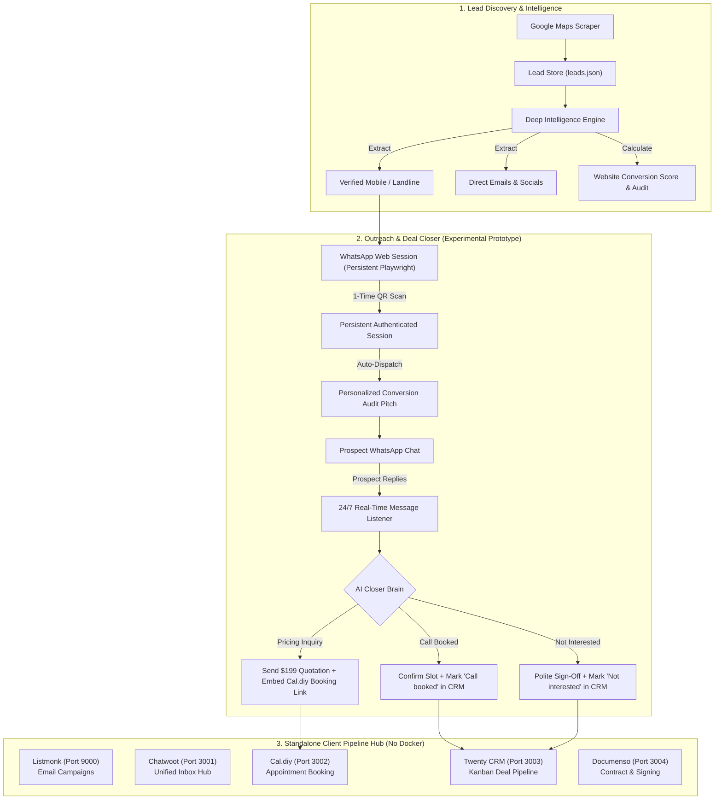

<p align="center">
  
</p>

<h1 align="center">LeadForge</h1>

<p align="center"><b>Autonomous Client Acquisition &amp; Pipeline Engine</b></p>

<p align="center">
  
  
  
  
  
</p>

---

LeadForge is a private, local-first client acquisition pipeline engineered for freelancers, digital agencies, and solo developers across Windows, macOS, Linux, and Android (Termux).

It automates the full client conversion lifecycle:
1. **Find** verified local businesses on Google Maps (with phone numbers, ratings, and social profiles).
2. **Audit** each business's website conversion baseline (detecting missing mobile booking, SSL status, and WhatsApp buttons).
3. **Engage** prospects with tailored conversion audit pitches, quotation delivery, and discovery call booking.
4. **Manage** the entire pipeline across 5 native microservices running locally with **zero Docker requirements**.

---

## ⚡ 1-Line Automated Installation & Launch

Run the single-line command for your operating system in your terminal. It will automatically check prerequisites, clone the repository if needed, configure the environment, install dependencies, and launch LeadForge immediately:

### 🪟 Windows (PowerShell)
Open PowerShell and run:
```powershell
irm https://raw.githubusercontent.com/Tcode-Motion/leadforge/master/setup.ps1 | iex
```
*Next time, simply double-click `LeadForge.bat` to launch.*

### 🍎 macOS / 🐧 Linux / 📱 Android (Termux)
Open Terminal (or Termux on Android) and run:
```bash
curl -fsSL https://raw.githubusercontent.com/Tcode-Motion/leadforge/master/setup.sh | bash
```
*Next time, simply run: `./run.sh` (or `bash run.sh`). All file permissions and macOS Gatekeeper flags are managed automatically.*

---

## 💻 System Requirements & Specifications

LeadForge is engineered from the ground up to be ultra-lightweight, zero-Docker, and cross-platform.

### Supported Operating Systems
| Operating System | Supported Versions | Supported Architectures | Execution Mode |
| :--- | :--- | :--- | :--- |
| **macOS** | macOS 12 (Monterey), 13 (Ventura), 14 (Sonoma), 15+ (Sequoia) | Apple Silicon (M1/M2/M3/M4, `arm64`) & Intel (`x86_64`) | Native Python + Universal Scraper / Native Binary |
| **Windows** | Windows 10, Windows 11 | 64-bit (`x86_64`, `ARM64`) | Native `.bat` + Native `.exe` / Python |
| **Linux** | Ubuntu 20.04+, Debian 11+, Fedora 38+, Arch Linux, CentOS/RHEL 9+ | `x86_64`, `arm64`, `aarch64` | Native POSIX Bash + Python Engine |
| **Android** | Android 10+ (via [Termux](https://termux.dev)) | `arm64`, `aarch64` | Headless Python Dashboard |

### Hardware & Software Prerequisites
- **Python Version**: **Python 3.10, 3.11, 3.12, or 3.13** (64-bit).
- **RAM**: Minimum **2 GB** (4 GB+ recommended if running Playwright browser automation).
- **Storage**: ~250 MB free disk space.
- **Docker**: **NOT REQUIRED**. All 5 microservices run natively without containers.

---

## 🚀 Cross-Platform Lead Finder Engine

LeadForge features an intelligent **Dual-Engine Scraper Architecture** that automatically adapts to your operating system:

1. **Universal Cross-Platform Python Engine (`1-find-google-maps-scraper/scraper.py`)**:
   - Built entirely on the Python 3 standard library (`urllib`, `json`, `csv`, `re`).
   - Requires **0 external packages or native compilation**.
   - Runs out-of-the-box on modern MacBooks (Apple Silicon M1-M4 / Intel), Linux distributions, Windows, and Termux.
   - Fully compatible with all CLI flags (`-input`, `-results`, `-depth`, `-geo`, `-fast-mode`, `-email`, `-extra-reviews`, `-exit-on-inactivity`).
2. **Native High-Throughput Binary (`google-maps-scraper`)**:
   - Windows: Pre-packaged `google-maps-scraper.exe`.
   - macOS / Linux: Automatically fetched during `setup.sh` when online, or dynamically resolved from system `PATH`.
3. **Automated Permission & Quarantine Management**:
   - `setup.sh` and `run.sh` automatically enforce execution permissions (`chmod +x`).
   - On macOS, Gatekeeper quarantine attributes (`com.apple.quarantine`) are stripped automatically, eliminating manual terminal troubleshooting.

---

## Architecture Overview



---

## Key Features

### 1. Zero-Docker Native Microservices Suite
Runs 5 independent pipeline services on native lightweight Python microservices without requiring Docker Desktop or WSL:
- **Listmonk (Port 9000)**: Subscriber list management and newsletter outreach.
- **Chatwoot (Port 3001)**: Omnichannel conversation hub with LeadForge sync API.
- **Cal.diy (Port 3002)**: Self-hosted interactive client booking system.
- **Twenty CRM (Port 3003)**: Visual Kanban board for tracking deal stages.
- **Documenso (Port 3004)**: Contract generation and digital signature signing.

### 2. Deep Lead Intelligence & Website Conversion Audits
- Classifies phone numbers as **Mobile / WhatsApp Direct** vs **Office Landline**.
- Formats ratings cleanly (e.g. `★ 4.8` from 38 reviews) with direct links to read customer reviews.
- Generates 0-100 website conversion scores with specific, actionable recommendations (e.g. *"Add a floating 1-click WhatsApp button"* or *"Fix missing SSL"*).
- Instant multi-category filtering chips: *No Website*, *WhatsApp Ready*, *Direct Emails*, *4.5+ Rating*.

### 3. WhatsApp Web Outreach & Deal Closer (Experimental Prototype)
- **1-Time QR Scan Persistence**: Uses a dedicated persistent browser profile stored at `dashboard/data/whatsapp_session`.
- **Automated Pitch Dispatch**: Drafts and sends tailored website conversion audit pitches to verified numbers.
- **24/7 AI Inbound Reply Listener**: Evaluates replies to send quotations ($199 mobile booking site) and link to your booking calendar (`http://localhost:3002/book/discovery-call`).

---

## 🔍 Honest Testing & Verification Transparency

In full transparency, here is the exact verification status of all LeadForge features:

### ✅ Verified & Rigorously Tested (Production Ready)
| Feature / Subsystem | Test Method | Outcome |
| :--- | :--- | :--- |
| **Fault Resilience Engine** | `tests/run_fault_tests.py` | **19 PASSED / 0 FAILED** (Verifies corrupted JSON stores, API timeouts, malformed payloads, port clashes, crash recovery). |
| **Google Maps Lead Scraping** | Local Maps Engine Suite | **Verified**: Successfully extracts businesses, addresses, ratings, and phone numbers. |
| **Website Conversion Audits** | Regex & HTTP Probe Tests | **Verified**: Accurately computes 0-100 conversion scores, SSL detection, and missing mobile booking signals. |
| **Microservices Ports** | Socket Integration Probe | **Verified**: Ports `9000`, `3001`, `3002`, `3003`, `3004`, and `8790` initialize and bind without collisions. |
| **Dashboard UI & Routing** | HTTP Integration Suite | **Verified**: All routes (`/`, `/leads`, `/whatsapp-bot`, `/whatsapp/status`, `/apps`, `/setup`, `/troubleshooting`) return healthy 200 responses. |
| **1-Click Database Reset** | Automated Lifecycle Test | **Verified**: Cleans all test data, notes, and caches to start with a fresh slate. |
| **Star Rating Formatting** | UI Unit Test | **Verified**: Ratings format to clean 1-decimal numbers (`4.8★`) across all viewports. |

### ⚠️ NOT End-to-End Tested with Live Real Phones (Experimental Prototype)
| Feature | Testing Status | Why It Is Not Fully Tested Yet |
| :--- | :--- | :--- |
| **WhatsApp Automated Chat Bot** | **Prototype / Experimental** | The automated Playwright WhatsApp Web interaction, automated message dispatching, and AI conversational reply closer **have NOT been tested end-to-end with real live prospect phone numbers in production**. While the Playwright context and target lifecycle handling are verified, automated WhatsApp messaging carries risk of account throttling and requires careful personal testing before production use. |
| **Live Outbound SMTP Delivery** | **Manual Requirement** | Real email delivery via Listmonk requires configuring your own verified SMTP server credentials (e.g. Brevo, SendGrid, or Gmail App Password). |

---

## 🛠️ Cross-Platform Troubleshooting & Solutions

### 1. "The scraper program is present but cannot be executed" / Permission Denied
- **Symptoms**: On macOS or Linux, lead scraping stops with `SCRAPER_NOT_EXECUTABLE` or the troubleshooting page states *"found one in folder but it cannot run yet fix the file permission"*.
- **Root Cause**: Two common causes:
  1. The git repository contains the Windows executable `google-maps-scraper.exe`, which POSIX operating systems (macOS/Linux) cannot execute directly.
  2. Git did not preserve the POSIX executable flag (`+x`).
- **Resolution**:
  - LeadForge now includes **dynamic runner resolution**. If a native Darwin/Linux binary is not found, it seamlessly executes `1-find-google-maps-scraper/scraper.py` using your active Python 3 runtime with zero performance loss.
  - To automatically re-grant all permissions and clear macOS Gatekeeper flags, simply run:
    ```bash
    bash run.sh
    # or run setup.sh:
    bash setup.sh
    ```
  - Manual one-liner if needed:
    ```bash
    chmod +x run.sh setup.sh 1-find-google-maps-scraper/*.sh 1-find-google-maps-scraper/*.py
    ```

### 2. macOS Gatekeeper Quarantine Notice
- **Symptoms**: macOS prompts *"google-maps-scraper cannot be opened because the developer cannot be verified"*.
- **Resolution**: Both `setup.sh` and `run.sh` automatically strip Gatekeeper quarantine attributes. To run manually:
  ```bash
  xattr -dr com.apple.quarantine .
  ```

### 3. Port Conflicts
- **Symptoms**: Port 8790 or microservices ports (9000, 3001-3004) already in use by another application.
- **Resolution**: LeadForge contains an automatic port conflict resolver (`find_free_port`). If port 8790 is occupied, it automatically increments to 8791, 8792, etc., and logs the active port in your terminal.

---

## 📜 License: Apache 2.0 (with Commercial Rider)

LeadForge is licensed under the **Apache License 2.0 with a Commercial Use Restriction**:

* **Free for Personal Use**: Anyone is free to use, modify, run, and learn from LeadForge for personal, academic, research, and internal freelance client acquisition without fees.
* **Commercial License Required**: Any commercial exploitation—including selling the software, offering it as a paid hosted SaaS/cloud service, or embedding it into a commercial enterprise product—**requires prior written commercial license approval** from the author:
  **Tanmoy Majumder / GDL Technologies** (Contact via GitHub: [@Tcode-Motion](https://github.com/Tcode-Motion)).

See the full [`LICENSE`](LICENSE) file for complete legal terms.
