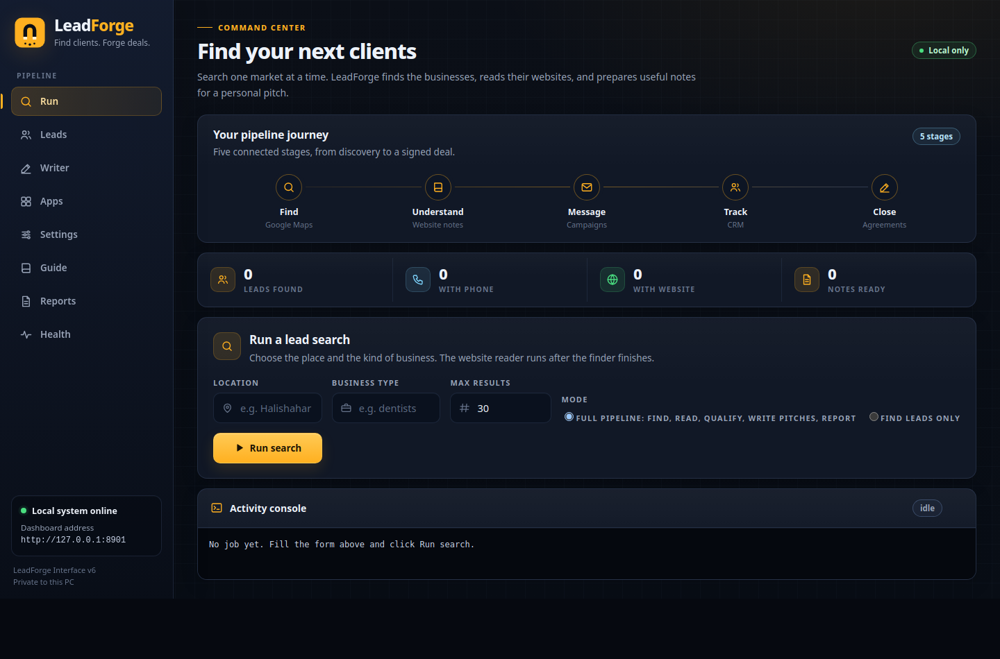

  

<h1 align="center">LeadForge</h1>

<b>Find clients. Forge deals.</b>

  
  
  
  
  
  

---

LeadForge is a local client finding pipeline for one person on one Windows
PC. It bundles seven free open source tools behind one dashboard and walks
a lead through five stages: find local businesses on Google Maps, read
their websites, qualify which ones truly have no working website, write a
personal pitch for each qualified lead with a free AI, then track replies,
calls and outcomes in one place. Everything runs on your own computer. No
server, no subscription, no ads.

---

## Screenshots

  

| Page | What it does |
| --- | --- |
| [Run](screenshots/run.png) | One Start button for the full pipeline, with a live activity console |
| [Leads](screenshots/leads.png) | Every lead in one table, with qualification and outcome |
| [Writer](screenshots/writer.png) | Write, edit and copy pitches, one lead or a batch of ten |
| [Apps](screenshots/apps.png) | Start, stop and open the five server apps |
| [Settings](screenshots/settings.png) | Setup forms for the apps and the AI writer, keys masked |
| [Guide](screenshots/guide.png) | Plain steps for keys, setup and safe sending |
| [Reports](screenshots/reports.png) | Automatic run reports and reply counts |
| [Health](screenshots/health.png) | Ports, Docker, disk and the recent error timeline |

---

## What it does

One click on the Run page runs the whole pipeline:

1. **Find.** The Google Maps scraper searches a location and a business
   type and saves the businesses it finds, with phone numbers and website
   fields.
2. **Read.** crawl4ai reads up to 15 lead websites and saves a short note
   per site, so a pitch can mention something real.
3. **Qualify.** Every lead is sorted into one class: no website confirmed,
   website dead, has website, or unknown. Only the first two are pitched
   by default. See docs/04-finding-and-qualifying.md for the exact method.
4. **Write.** The AI writer drafts a WhatsApp message and an email per
   qualified lead, using your Pitch Playbook, checked for format and for
   AI sounding phrases, with one automatic fix pass each.
5. **Check and report.** Outcomes and replies are counted, a report is
   saved to the Reports page, and what worked feeds back into the next
   pitches.

You can also run Find leads only, and do the rest by hand.

---

## Features

**Finding**

- Google Maps search by location and business type, 1 to 200 results
- Result count mapped to scraper scroll depth (approximate by design)
- Strict CSV checks: a broken result file never replaces the last good one
- One job at a time, with a live console and clear stage lines

**Reading**

- Website reading for up to 15 sites per run, one note saved per site
- One failing website never stops the others; counts are always reported

**Qualifying**

- Four classes: no_website_confirmed, website_dead, has_website, unknown
- Computed from the listing plus the reader result, never guessed
- Qualification chip and filter on the Leads page

**Writer**

- Cloud AI: Google Gemini (gemini-2.0-flash) or Groq
  (llama-3.3-70b-versatile), free keys, stored locally and masked
- Local AI: any OpenAI compatible local server, Ollama by default, with a
  status check and one click model download (qwen2.5:3b recommended)
- Manual web mode: copy an instruction into any web AI and paste the reply
  back; a saved web assistant setup makes later copies short
- Pitch Playbook: your rules and examples, used by every route
- Output checker with one correction retry, AI style checker with one
  humanize rewrite, and a retry ladder across providers
- Region language pack with Auto (by region) as the default
- Batch writing for the first 10 qualified leads, one lead at a time so a
  single failure never loses the rest
- What is working card: the writer learns from the outcomes you mark

**Settings**

- In-UI setup forms for chatwoot, cal.diy, twenty and documenso; secrets
  auto generate when left blank and are never shown again after saving
- listmonk guidance card (its sending setup lives inside listmonk)
- Live Setup status panel naming the exact fields still missing
- Chatwoot reply check settings with a masked token

**Apps**

- Start, stop, open and start all for listmonk, chatwoot, cal.diy, twenty
  and documenso, with status pills and per app output
- Automatic port switching when a port is busy, saved across restarts
- Setup needed state with the exact fix instead of a raw Docker error

**Reports**

- Automatic markdown report after every full pipeline run
- Counts for found, qualified, pitched, failed, replied, calls booked,
  not interested and still new
- Chatwoot reply check that matches open conversations to leads by phone

**Health**

- Dashboard, Docker, disk, data folder and log checks in one page
- Live ports table for the dashboard and every app
- Recent error timeline with plain language fixes, and a clear button
- Structured logs in dashboard/data/logs with rotation

**Safety**

- Dashboard binds to 127.0.0.1 only, and picks the next free port from
  8790 upward when the usual one is busy
- Friendly errors everywhere: no stack traces in the browser, ever
- Keys and secrets are redacted from logs, pages and reports
- Safe sending rules built into the Guide: official WhatsApp Business API
  with approved templates, opt out line, small batches, and honest email
  warm up guidance

The complete map, with the page and code area for every feature, is in
[docs/FEATURES.md](docs/FEATURES.md).

---

## Quick start

1. Unzip the repository anywhere on your Windows PC.
2. Install Python 3.12 from python.org and tick "Add python.exe to PATH".
3. Install Docker Desktop (only needed for the five server apps; finding
   and writing work without it).
4. Double click `LeadForge.bat`. Your browser opens at the real dashboard
   address. If port 8790 is busy, LeadForge picks the next free one and
   the launcher opens that address.
5. Open the **Guide** page and follow the cards in order.
6. Open **Settings** and fill what the Setup status panel asks for: an AI
   key (or none, using manual mode), and the app setup forms when you
   want the server apps.
7. Open **Run**, type a location and a business type, leave the mode on
   Full pipeline, and click Run search.

First run walkthrough: [docs/01-getting-started.md](docs/01-getting-started.md).

---

## The seven bundled tools

LeadForge's own code is the dashboard and the glue. The heavy lifting is
done by seven free tools, kept in their numbered folders. Each tool keeps
its own license.

| Folder | Tool | Job in the pipeline | License | Upstream |
| --- | --- | --- | --- | --- |
| 1-find-google-maps-scraper | google-maps-scraper by gosom | Finds businesses on Google Maps | MIT | https://github.com/gosom/google-maps-scraper |
| 2-understand-crawl4ai | crawl4ai by unclecode | Reads lead websites into clean notes | Apache 2.0 | https://github.com/unclecode/crawl4ai |
| 3-message-listmonk | listmonk by knadh | Sends email campaigns | AGPL v3 | https://github.com/knadh/listmonk |
| 4-inbox-chatwoot | chatwoot | One inbox for WhatsApp, email and chat | MIT core (enterprise parts under their own license) | https://github.com/chatwoot/chatwoot |
| 5-book-caldiy | cal.diy by Cal.com | Booking page for calls | MIT | https://github.com/calcom/cal.diy |
| 6-track-twenty | twenty | CRM for leads, replies and deals | AGPL v3 (some files under an enterprise license) | https://github.com/twentyhq/twenty |
| 7-close-documenso | documenso | Proposals and e-signing | AGPL v3 | https://github.com/documenso/documenso |

---

## System requirements

- Windows 10 or 11
- Python 3.12 (dashboard and the website reader)
- Docker Desktop for the five server apps (not needed for finding leads
  or writing pitches)
- About 8 GB RAM is workable: run one server app at a time on a small PC,
  and prefer the 3B local AI model. More RAM makes everything easier.
- Ports: the dashboard prefers 8790 and scans upward to 8899. Each app
  prefers its own port (9000, 3001, 3002, 3003, 3004) plus its database
  and cache ports, and LeadForge moves any busy one automatically.

---

## How it works

The dashboard (dashboard/app.py) is one Python file using only the
standard library. It serves the eight pages, runs the pipeline job in the
background, starts and stops the Docker apps, stores leads and settings
as JSON files under dashboard/data, and writes structured logs.
LeadForge.bat starts it with a fresh launch token and opens the browser
at the address written into dashboard/data/server-info.json, which is how
the launcher always lands on the real port, even after a switch.

Full detail: [docs/02-architecture.md](docs/02-architecture.md).

---

## Privacy and safety

- Nothing leaves your PC except the calls you configure: the AI provider
  you pick receives the lead facts needed to write a pitch, the scraper
  talks to Google Maps, the reader visits lead websites, and Docker pulls
  the bundled apps' images. Manual web mode sends nothing by itself.
- Keys are stored in plain local files on your PC (dashboard/data and the
  app .env files), are masked in the UI, and are redacted from every log
  and report. Never commit them; the .gitignore blocks them.
- WhatsApp first contact must go through the official WhatsApp Business
  API inside chatwoot, with an approved template and an opt out line, in
  small batches. No tool can promise zero flags, and LeadForge does not.
  Read docs/07-sending-safely.md before sending anything.

---

## Known limits

- Google can show bot checks or change Maps at any time, so a search can
  return fewer results than asked, or none. The Run page says so plainly.
- Max results is approximate: the scraper has no exact limit setting, so
  LeadForge maps your number to a scroll depth.
- Upstream, listmonk and chatwoot both default their Postgres to host
  port 5432. LeadForge remaps host ports automatically, and still, on a
  small PC it is simplest to run one server app at a time.
- The dashboard only runs while its window is open, so the chatwoot reply
  check runs when you open the Reports page, not in the background.
- Email replies land in your mailbox, not in LeadForge, unless you
  connect that mailbox to chatwoot. Until then, mark email outcomes by
  hand on the Leads page.
- Docker, live AI calls and a real Ollama install can only be fully
  tested on a real Windows PC; on the build machine they are covered by
  stub tests (see tests/).

---

## FAQ

**The port is busy. What now?**
Nothing. LeadForge moves to the next free port by itself and the launcher
opens the real address. The Health page lists every port in use.

**Docker is not running.**
Start Docker Desktop, wait until it says it is running, then press Start
on the app card again. The Apps and Health pages show the exact state.

**I have no AI key.**
Use Manual mode on the Writer page (copy, paste into any web AI, paste
the reply back), or install Ollama and use Local AI. Both are free. The
Guide page has the steps.

**Ollama is not installed.**
Settings shows the official download link and the steps. After installing,
click Check local AI, then Download model (one click).

**The scraper returned 0 leads.**
Check the location spelling, try a wider area (a city instead of a small
locality), and run again later; Google sometimes limits rapid searches.
The activity console shows the scraper's own words.

---

## Documentation

- [docs/01-getting-started.md](docs/01-getting-started.md): install, first
  run, first lead search
- [docs/02-architecture.md](docs/02-architecture.md): components, data
  flow, ports, logs, file layout
- [docs/03-dashboard-pages.md](docs/03-dashboard-pages.md): every page and
  every button
- [docs/04-finding-and-qualifying.md](docs/04-finding-and-qualifying.md):
  the scraper, the reader and the four qualification classes
- [docs/05-ai-writer.md](docs/05-ai-writer.md): providers, keys, local AI,
  manual mode, playbook, checkers, retry ladder, region pack
- [docs/06-app-setup.md](docs/06-app-setup.md): per app setup fields and
  secrets
- [docs/07-sending-safely.md](docs/07-sending-safely.md): WhatsApp and
  email sending rules
- [docs/08-reports-and-outcomes.md](docs/08-reports-and-outcomes.md): the
  lead store, outcomes, reports and the reply check
- [docs/09-troubleshooting.md](docs/09-troubleshooting.md): every error
  code and its fix
- [docs/10-hosting-later.md](docs/10-hosting-later.md): optional notes for
  later, only if an always on inbox is ever wanted
- [docs/FEATURES.md](docs/FEATURES.md): the full feature map
- [DASHBOARD.md](DASHBOARD.md), [START_HERE.md](START_HERE.md) and
  [PIPELINE_FLOW.md](PIPELINE_FLOW.md): the original pack guides

---

## License

LeadForge's own code and documentation are under the MIT License, (c) 2026
Tanmoy Majumder / GDL Technologies. See [LICENSE](LICENSE).

The seven bundled tools keep their own licenses, listed in the table
above. Their folders contain the upstream files as provided by their
projects.
